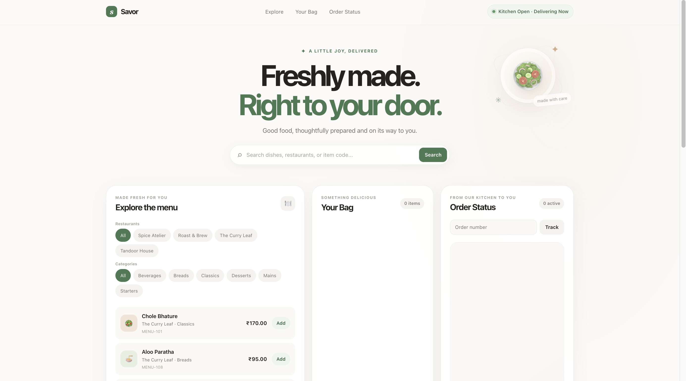
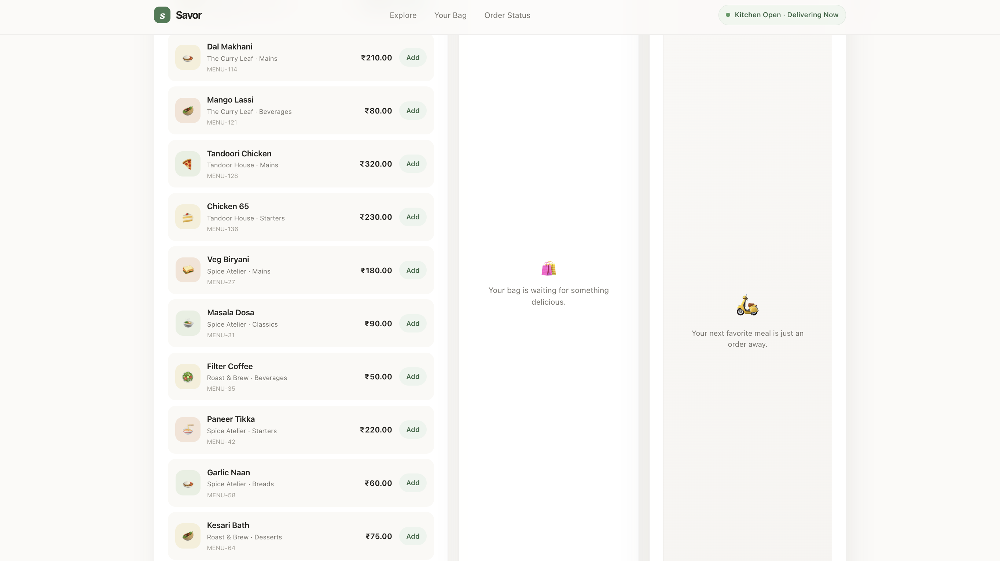
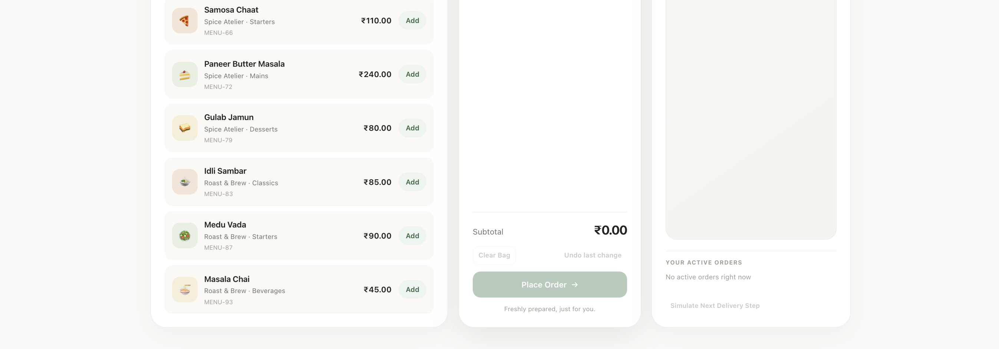

# Online Food Ordering System (Savor)

An interactive web app that teaches core data structures (linked list, hash set, queue and more) through a familiar scenario: ordering food online. Instead of abstract nodes and arrays, you watch the structures work on things like orders, menu items and a cart.

## Overview

Data structures are easier to understand when they solve a real problem. This project models an online food ordering flow and shows how each structure fits into it, with a C/C++ backend doing the work and a browser frontend visualizing the results.

## Data Structures Covered

| Data Structure | Role in the Food Ordering Flow |
|---|---|
| Linked List | Represents the cart or order history, with items added and removed dynamically |
| Hash Set | Enables fast lookup of menu items and prevents duplicate entries |
| Queue | Holds incoming orders and processes them first come, first served |
| Stack | Powers the "Undo last change" button in the bag |

## Tech Stack

- **Backend:** C / C++ (`server.cpp`, `hash_core.c`, `hash_core.h`)
- **Frontend:** HTML, CSS, JavaScript (`index.html`, `style.css`, `app.js`)

## Project Structure

```
Online Food Ordering System/
├── backend/
│   ├── hash_core.c      # Hash set implementation
│   ├── hash_core.h      # Hash set header
│   └── server.cpp       # Backend server
├── frontend/
│   ├── index.html       # Page structure
│   ├── style.css        # Styling
│   └── app.js           # Frontend logic and visualization
└── README.md
```

## Getting Started

### Prerequisites

- A C++17 compiler (`clang++` on macOS, or `g++` on Linux)
- A modern web browser

### Build and Run

From the project root folder:

```bash
# 1. Compile the backend
clang++ -std=c++17 -Ibackend backend/server.cpp backend/hash_core.c -o food_server

# 2. Start the server
./food_server
```

Keep the terminal window open while the server is running, then open **http://localhost:8080** in your browser.

To stop the server, press `Ctrl+C` in the terminal. To run it again without rebuilding, just run `./food_server`.

## Features

- **Browse the menu** across four restaurants (Spice Atelier, Roast & Brew, The Curry Leaf, Tandoor House)
- **Filter** dishes by restaurant and by category (Starters, Mains, Breads, Classics, Desserts, Beverages)
- **Search** by dish name, restaurant, or item code (for example `MENU-101`)
- **Add items to your bag** with a live subtotal in rupees
- **Undo last change** and **Clear Bag** controls for editing your order
- **Place an order** and receive an order number
- **Track orders** by order number and view all active orders
- **Simulate delivery steps** to watch an order move through the kitchen to your door

## Screenshots

### Home



### Menu



### Bag and Order Status



## Author

**Snehil**
GitHub: [@SNEHIIIL](https://github.com/SNEHIIIL)
